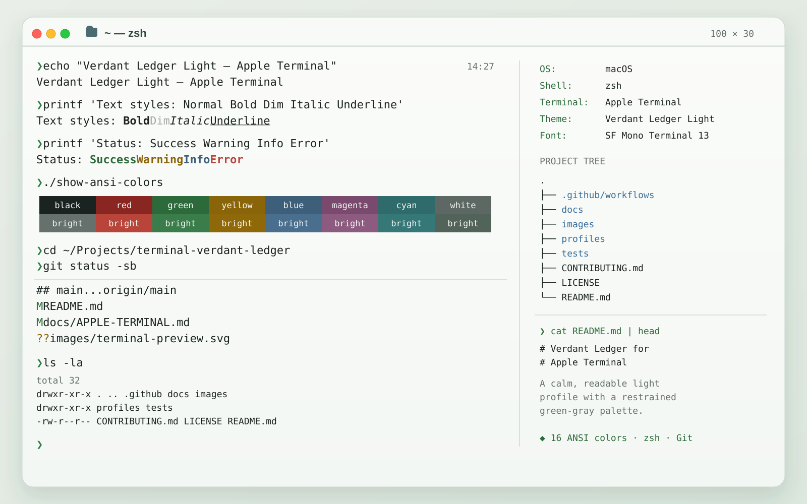

# Verdant Ledger for Apple Terminal

A light Apple Terminal profile adapted from the [Verdant Ledger Light theme for Visual Studio Code](https://github.com/nelvaron/vscode-verdant-ledger).

## Preview



## Profile

- **Profile:** `Verdant Ledger Light`
- **File:** [`profiles/Verdant-Ledger-Light.terminal`](profiles/Verdant-Ledger-Light.terminal)
- **Background:** `#F6F8F6`
- **Foreground:** `#1B2320`
- **Cursor:** `#2D6A3B`
- **Selection:** `#D5E1D8`
- **Font used during visual validation:** SF Mono Terminal Regular, 13 pt
- **Shell tested:** zsh

The `Bright White` ANSI entry is adjusted to `#52635A` for better contrast against the light background. This change applies only to this Terminal profile; it does not alter the [original VS Code theme](https://github.com/nelvaron/vscode-verdant-ledger).

## Install

1. Download `profiles/Verdant-Ledger-Light.terminal`.
2. Open the file, or import it from **Terminal → Settings → Profiles**.
3. Select **Verdant Ledger Light** for a window. Set it as the default profile in **Terminal → Settings → General** if desired.

## Validate

Run the automated tests with Python 3:

```sh
python3 -m unittest discover -s tests -v
```

The tests validate the plist structure, profile identity, core colors, and all 16 ANSI color values. They do not emulate Apple's Terminal UI; a manual import and visual smoke test on macOS is still required.

See [Apple Terminal documentation](docs/APPLE-TERMINAL.md) for the full palette and test commands.

## Contributing

See [CONTRIBUTING.md](CONTRIBUTING.md).

## License

[MIT](LICENSE)
