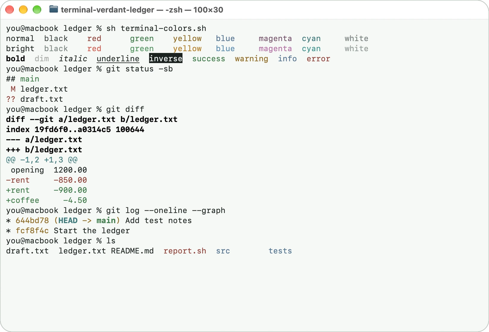

# Verdant Ledger for Apple Terminal

[](https://github.com/nelvaron/terminal-verdant-ledger/actions/workflows/validate-profile.yml)

A light Apple Terminal profile adapted from the [Verdant Ledger Light theme for Visual Studio Code](https://github.com/nelvaron/vscode-verdant-ledger).

## Preview



A screenshot of Apple Terminal on macOS running [`scripts/demo.sh`](scripts/demo.sh) at 100 × 30. Run the same script to try the profile with your own font:

```sh
sh scripts/demo.sh
```

## Profile

- **Profile:** `Verdant Ledger Light`
- **File:** [`profiles/Verdant-Ledger-Light.terminal`](profiles/Verdant-Ledger-Light.terminal)
- **Background:** `#F6F8F6`
- **Foreground:** `#1B2320`
- **Cursor:** `#2D6A3B`
- **Selection:** `#D5E1D8`
- **Font used during visual validation:** SF Mono Terminal Regular, 13 pt
- **Shell tested:** zsh

The ANSI colors follow the [VS Code theme](https://github.com/nelvaron/vscode-verdant-ledger) with two Terminal-only adjustments: normal colors are darkened to at least 7:1 so that each one is clearly different from its bright variant, and bright white is the lightest gray (`#7F8A86`). See [the palette notes](docs/APPLE-TERMINAL.md#normal-and-bright-colors) for the reasons and measurements. The VS Code theme is unchanged.

## Install

1. Download `profiles/Verdant-Ledger-Light.terminal`.
2. Open the file, or import it from **Terminal → Settings → Profiles**.
3. Select **Verdant Ledger Light** for a window. Set it as the default profile in **Terminal → Settings → General** if desired.

## Change the colors

Apple Terminal stores each color as a base64-encoded binary archive, so the profile is not edited by hand. Edit [`scripts/palette.json`](scripts/palette.json), then regenerate the profile:

```sh
python3 scripts/generate_profile.py
```

## Validate

Run the automated tests with Python 3:

```sh
python3 -m unittest discover -s tests -v
```

The tests check that the profile parses, matches the palette and the generator output, meets the contrast targets, and agrees with the documented palette. On pushes to `main` and on pull requests, GitHub Actions also decodes each color with AppKit on macOS. None of this emulates Terminal's UI, so import the profile and check it visually on macOS after changing it.

See [Apple Terminal documentation](docs/APPLE-TERMINAL.md) for the full palette and test commands.

## Accessibility

Contrast targets, known barriers, and how to report a problem are described in
[ACCESSIBILITY.md](ACCESSIBILITY.md).

## Contributing

See [CONTRIBUTING.md](CONTRIBUTING.md).

## License

[MIT](LICENSE)
